# Pustakalaya

**Pustakalaya (पुस्तकालय)** is an offline-ready library management system for cataloging books, managing physical copies across branches, handling memberships and circulation, processing reservations and fines, and maintaining an auditable operational record.

It is designed for the Lucknow Public Library Network and runs locally with a Flask web interface backed by SQLite. A Windows executable and portable ZIP are available from the [v1.0.0 release](https://github.com/hmmlavi/Pustakalaya-LMS/releases/tag/v1.0.0).

Useful links: [screenshots](#screenshots) · [Windows quick start](#option-1-windows-packaged-application) · [source quick start](#option-2-run-from-source) · [testing](#testing-and-development) · [release assets](https://github.com/hmmlavi/Pustakalaya-LMS/releases)

## Overview

Pustakalaya gives library staff one local workspace for:

- maintaining a searchable catalog and branch-level copy inventory;
- registering members and applying BASIC, STANDARD, and PREMIUM borrowing policies;
- issuing, returning, renewing, and reporting damaged or lost physical copies;
- managing deterministic FIFO reservations and pickup deadlines;
- assessing, paying, and waiving INR fines with an auditable ledger;
- importing historical records with validation and quarantine reporting; and
- reviewing operational reports and safe CSV exports.

The application is intentionally local-first. SQLite is configured for reliable single-host operation with foreign-key enforcement, WAL mode, busy-timeout handling, and explicit write transactions. It is not a multi-node library service without moving the database layer to a client-server database.

## Screenshots

These screenshots were captured from the running Pustakalaya application using synthetic demonstration data. They are not mockups.

<table>
  <tr>
    <td>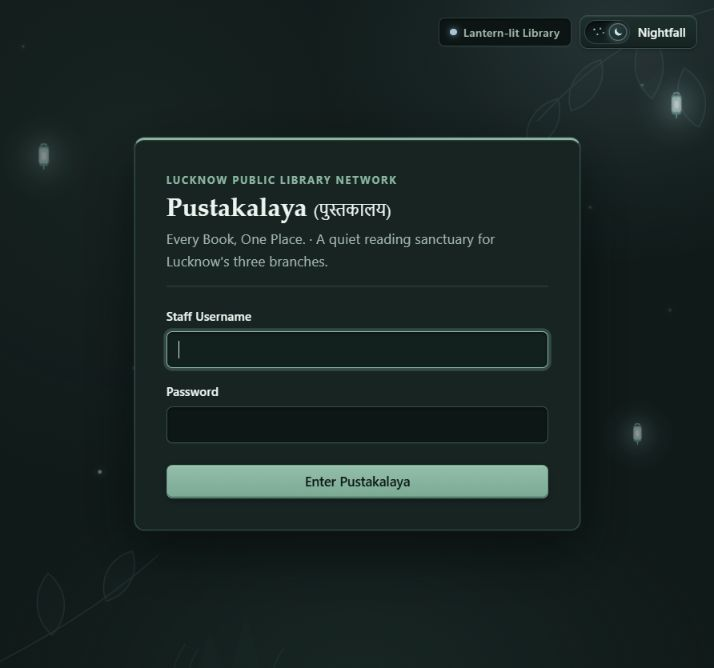<br><sub>Sign-in screen with the Moonlit Forest theme.</sub></td>
    <td>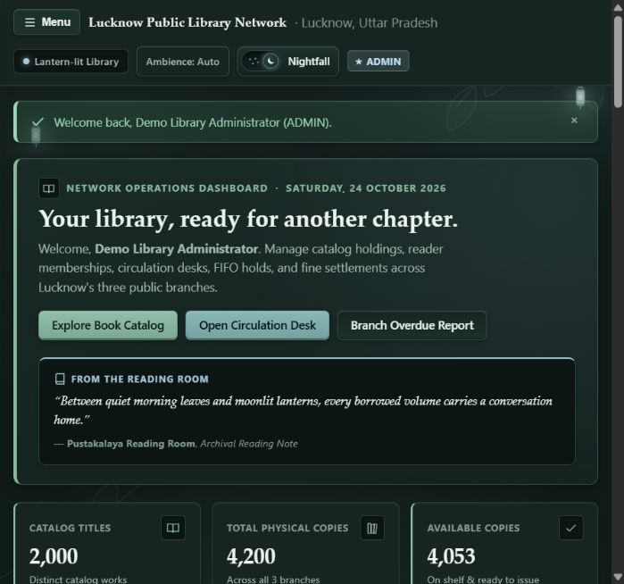<br><sub>Operations dashboard with catalog, circulation, branch, and fine summaries.</sub></td>
  </tr>
  <tr>
    <td>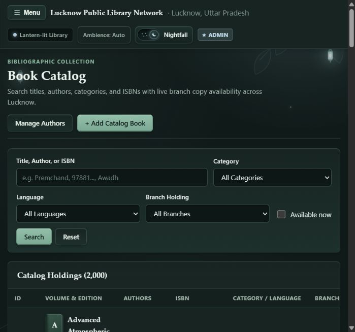<br><sub>Searchable catalog with category, language, branch, and availability filters.</sub></td>
    <td>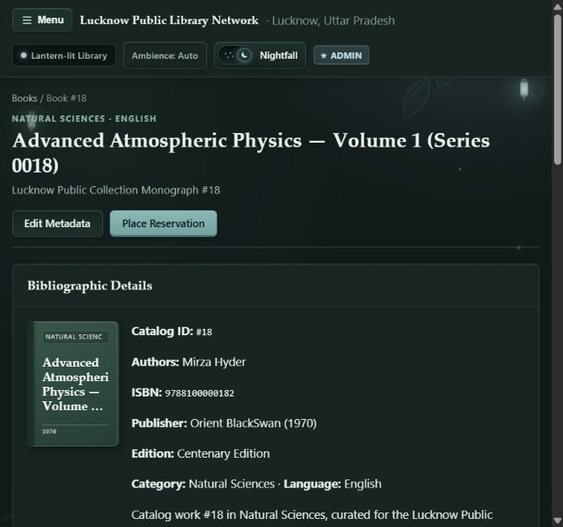<br><sub>Book metadata, branch availability, and physical-copy management.</sub></td>
  </tr>
  <tr>
    <td>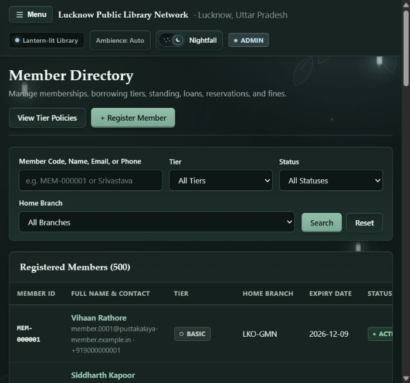<br><sub>Member directory with tier and membership-status filters.</sub></td>
    <td>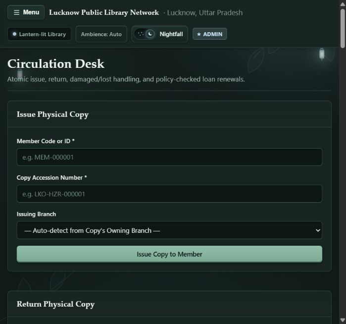<br><sub>Issue and return workflows for physical copies.</sub></td>
  </tr>
  <tr>
    <td>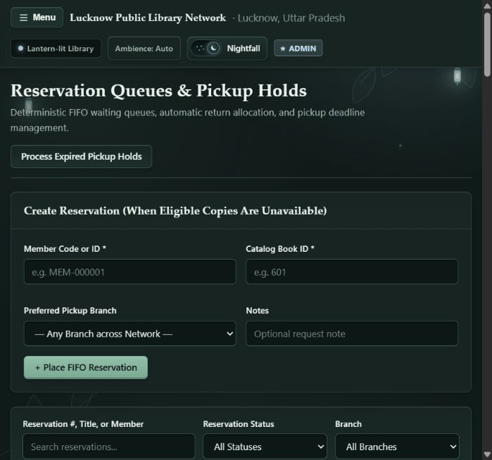<br><sub>FIFO reservation queues and pickup-hold processing.</sub></td>
    <td>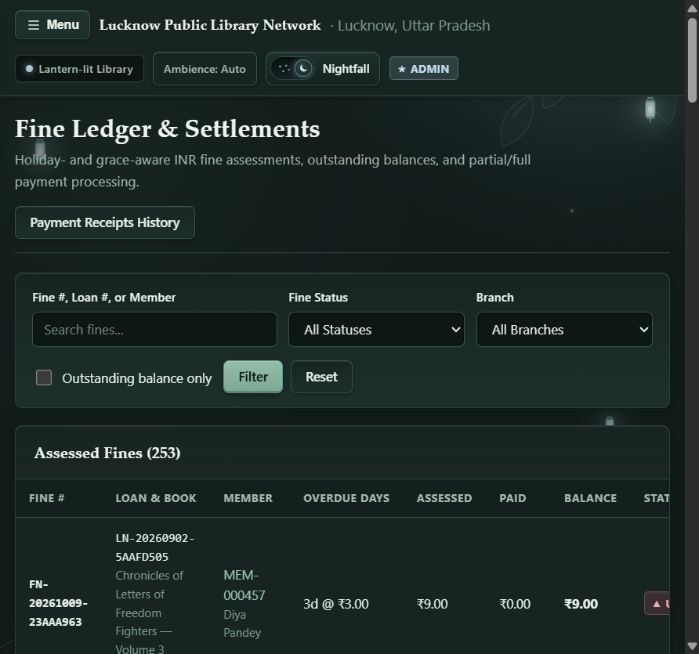<br><sub>Fine filtering, outstanding balances, and payment workflows.</sub></td>
  </tr>
  <tr>
    <td>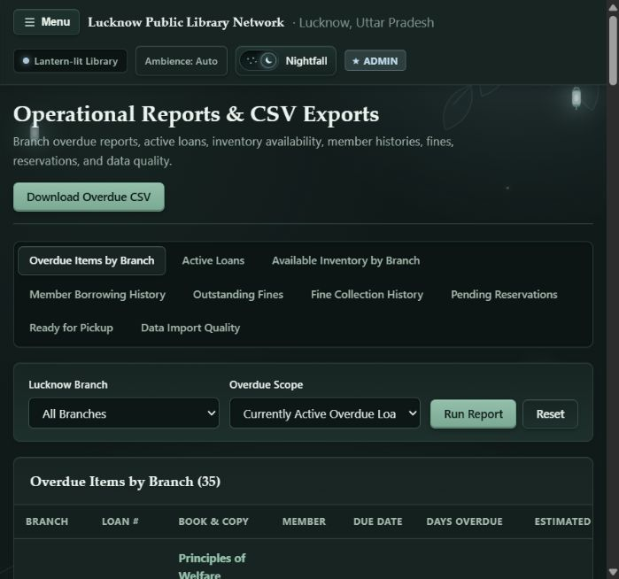<br><sub>Operational reports and CSV export access.</sub></td>
    <td>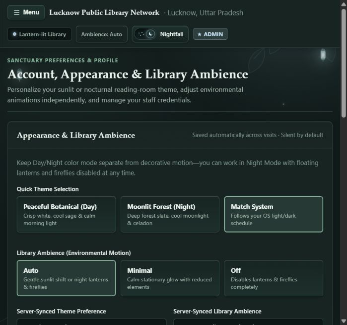<br><sub>Appearance, ambience, and staff-account settings.</sub></td>
  </tr>
</table>

## Features

### Catalog and inventory

- ISBN-10 and ISBN-13 checksum validation, with optional ISBNs for eligible heritage records.
- Duplicate-aware author and book handling.
- Multiple physical copies per catalog work, unique accession numbers, owning branches, acquisition dates, and condition notes.
- Validated copy states including `AVAILABLE`, `ON_LOAN`, `RESERVED`, `LOST`, `DAMAGED`, and `WITHDRAWN`.
- Branch-level availability and catalog search by title, author, category, language, ISBN, and branch.

### Members and circulation

- Member registration, editing, status changes, expiry dates, contact details, home branches, and membership tiers.
- Tier policies for loan limits, loan duration, renewals, reservation limits, grace periods, fine rates, caps, and borrowing blocks.
- Atomic issue, return, renewal, damaged-copy, and lost-copy workflows.
- Holiday-aware due dates and overdue calculations.
- SQLite write locking and conditional updates to prevent double checkout of one physical copy.

### Reservations and fines

- Eligibility checks and duplicate prevention for reservations.
- Deterministic FIFO queues with automatic allocation after returns.
- Pickup deadlines, expired-hold processing, and idempotent reallocation.
- Exact INR money handling using integer paise storage and `Decimal` calculations.
- Partial and full payments, idempotency keys, administrative waivers, payment receipts, and audit history.

### Administration and data quality

- Role-based access control for `ADMIN`, `LIBRARIAN`, and `STAFF_READONLY` accounts.
- First-run administrator setup and last-active-administrator protection.
- Branch, tier, holiday, staff, audit, and correction workflows.
- Historical import validation with accepted, rejected, quarantined, duplicate, and error dispositions.
- Dataset verification for migrations, SQLite integrity, foreign keys, counts, and operational invariants.
- Report pages for overdue items, active loans, inventory, member history, fines, reservations, and data quality.

### Windows distribution

- Standalone `Pustakalaya.exe` and portable ZIP distribution.
- Bundled templates, CSS, JavaScript, migrations, and Alembic configuration.
- Persistent runtime data outside the build directory, under `%LOCALAPPDATA%\\Pustakalaya` by default.
- SHA-256 manifest for release downloads.

## Technology and architecture

- **Python 3.12 in CI**, with Flask 3, Flask-WTF, WTForms, Werkzeug, SQLAlchemy 2, Alembic, SQLite, `python-dotenv`, and `tzdata`.
- **Web layer:** Flask blueprints, server-rendered Jinja templates, Flask-WTF CSRF protection, and local CSS/JavaScript assets.
- **Application layer:** domain entities, policies, state machines, services, repositories, and explicit transaction boundaries.
- **Persistence layer:** SQLAlchemy models and repositories over SQLite, with versioned Alembic migrations.
- **Packaging:** PyInstaller spec and a Windows launcher that applies migrations, starts the local server, and opens the browser.

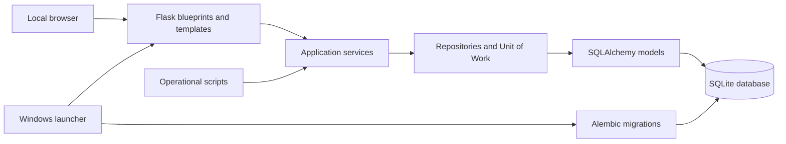

## Installation and quick start

### Option 1: Windows packaged application

Download the current assets from the [Pustakalaya v1.0.0 release](https://github.com/hmmlavi/Pustakalaya-LMS/releases/tag/v1.0.0):

1. Choose [`Pustakalaya.exe`](https://github.com/hmmlavi/Pustakalaya-LMS/releases/download/v1.0.0/Pustakalaya.exe) for the direct executable, or download [`Pustakalaya-windows-portable.zip`](https://github.com/hmmlavi/Pustakalaya-LMS/releases/download/v1.0.0/Pustakalaya-windows-portable.zip) and extract it.
2. Run `Pustakalaya.exe`. The launcher starts the local server and opens the browser at the local sign-in page.
3. On a new database, open `/auth/setup` in the local application and create the first administrator account.
4. Verify downloads with [`SHA256SUMS.txt`](https://github.com/hmmlavi/Pustakalaya-LMS/releases/download/v1.0.0/SHA256SUMS.txt) if required.

The packaged application stores its database, logs, and generated runtime files in `%LOCALAPPDATA%\\Pustakalaya` by default. Set `PUSTAKALAYA_DATA_DIR` to another writable directory before launching if needed. The package is portable, not a system-wide installer, and does not require administrator privileges.

Troubleshooting:

- If the browser does not open, visit `http://127.0.0.1:5000` manually unless `PORT` was changed.
- If the port is busy, set `PORT` to another local port before launching.
- If first-run setup is unavailable, a staff account already exists; sign in or use an administrator account to manage staff.
- Keep the runtime directory writable and do not delete the database while the application is running.

### Option 2: Run from source

Prerequisite: Python 3.12 or a compatible supported Python installation.

```powershell
git clone https://github.com/hmmlavi/Pustakalaya-LMS.git
cd Pustakalaya-LMS
python -m venv .venv
.\\.venv\\Scripts\\Activate.ps1
python -m pip install -r requirements-dev.txt
Copy-Item .env.example .env
```

Edit `.env` and set a strong `SECRET_KEY` for any persistent or production-like deployment. Then initialize the database and create the first administrator:

```powershell
python scripts\\initialize_db.py --admin-username admin --prompt-admin-password
python run.py
```

Open `http://127.0.0.1:5000`. Alternatively, apply migrations and complete first-run setup from the browser:

```powershell
alembic upgrade head
python run.py
```

Optional deterministic demonstration data and historical import:

```powershell
python scripts\\seed_data.py
python scripts\\import_history.py
python scripts\\process_reservations.py
python scripts\\verify_data.py
```

The source workflow uses the same commands on Linux and macOS with the usual `python3`, virtual-environment activation, and path syntax for those systems.

## Configuration

Configuration is loaded from environment variables and an optional root `.env` file. Explicit environment variables take precedence over `.env` values.

| Variable | Purpose | Default |
| --- | --- | --- |
| `FLASK_ENV` | `development`, `production`, or another deployment label | `development` |
| `SECRET_KEY` | Flask session signing key | Ephemeral key in development; required in production |
| `DATABASE_URL` | SQLAlchemy database URL | SQLite database in the runtime data directory |
| `PUSTAKALAYA_DATA_DIR` | Writable runtime-data directory for databases and logs | `%LOCALAPPDATA%\\Pustakalaya` in the package; `instance/` from source |
| `LIBRARY_TIMEZONE` | Operational library timezone | `Asia/Kolkata` |
| `SESSION_LIFETIME_MINUTES` | Permanent session lifetime | `480` minutes, minimum `15` |
| `PICKUP_HOLD_DAYS` | Pickup deadline duration | `3` days |
| `SEED_RANDOM_SEED` | Deterministic seed-data random seed | `20261024` |
| `HISTORICAL_REFERENCE_DATE` | Reference date for generated historical data | `2026-10-24` |
| `HISTORICAL_DAYS` | Historical window length | `365` |
| `HOST` / `PORT` | Local server bind host and port | `127.0.0.1` / `5000` |

For scripted bootstrap only, `PUSTAKALAYA_ADMIN_USERNAME`, `PUSTAKALAYA_ADMIN_PASSWORD`, and `PUSTAKALAYA_ADMIN_FULL_NAME` may be supplied to `scripts/initialize_db.py`. Do not commit those values or place production credentials in `.env.example`.

Development may generate an ephemeral secret when `SECRET_KEY` is absent. Production requires an explicitly configured persistent secret, HTTPS/TLS, and appropriate reverse-proxy controls.

## Usage guide

1. **First-run setup:** apply migrations, then create the first administrator at `/auth/setup` or with `initialize_db.py`.
2. **Catalog:** open **Books**, search or add a catalog work, manage authors, and add physical copies assigned to branches.
3. **Members:** register a member, choose a tier and home branch, and update membership status or expiry when needed.
4. **Circulation:** use **Circulation** to issue a copy, return it, renew an active loan, or report a damaged/lost copy.
5. **Reservations:** place a reservation when eligible copies are unavailable; process expired pickup holds from **Reservations** or the scheduled script.
6. **Fines:** review the fine ledger, record partial or full payments, and apply administrative waivers when authorized.
7. **Reports:** select a report type and branch filter, then use the overdue CSV export where appropriate.
8. **Administration and settings:** manage roles, branches, tiers, holidays, audit records, corrections, appearance, and ambience preferences according to the signed-in role.

## Project structure

```text
Pustakalaya-LMS/
├── app/
│   ├── domain/           # Entities, value objects, policies, enums, and state machines
│   ├── infrastructure/  # Database, transactions, logging, and deterministic seed data
│   ├── models/           # SQLAlchemy ORM mappings
│   ├── repositories/     # Persistence queries and pagination
│   ├── services/         # Authentication, catalog, circulation, fines, imports, and reports
│   └── web/              # Blueprints, forms, templates, CSS, and JavaScript
├── migrations/           # Alembic schema history
├── packaging/            # PyInstaller spec and Windows launcher
├── scripts/              # Initialization, seed, import, reservation, and verification commands
├── tests/                # Unit, integration, concurrency, import, DOM, theme, and RBAC tests
├── docs/                 # Architecture, business rules, data quality, testing, and screenshots
├── .github/workflows/    # CI and tagged Windows release workflows
└── run.py                # Source entry point
```

## Testing and development

Install the development dependencies, then run:

```powershell
python -m pytest -q
python scripts\\verify_data.py --json
```

`verify_data.py` expects a migrated and populated operational database when checking dataset counts. The test suite uses isolated temporary databases. The current suite contains 57 tests.

The [CI workflow](.github/workflows/ci.yml) runs on pushes to `main` and pull requests targeting `main`. It checks dependency consistency, verifies a fresh migration, and runs the full test suite.

To build Windows artifacts locally:

```powershell
python -m pip install -r requirements-dev.txt pyinstaller==6.16.0
.\\scripts\\build_windows.ps1
```

The [Windows release workflow](.github/workflows/release-windows.yml) runs for tags matching `v*.*.*`. It tests the project, builds the executable and portable ZIP, checks exact artifact names and checksums, launches the package in a clean data directory, and publishes the three release assets.

## Security and data management

- Passwords are stored using Werkzeug password hashing; raw passwords are not stored in the database.
- Flask-WTF protects applicable state-changing forms with CSRF tokens.
- Authentication reloads the active user on each request and clears sessions for inactive or missing accounts.
- Role checks are enforced server-side for administrative, circulation, member, reservation, fine, and settings actions.
- CSV exports protect against spreadsheet formula injection.
- The default bind address is loopback (`127.0.0.1`). Do not expose the development server directly to the internet.
- For production-like deployments, use a persistent `SECRET_KEY`, TLS/HTTPS, reverse-proxy rate limiting, and a supported database deployment strategy.

Back up the SQLite database with SQLite-aware tooling while the application is stopped or after a consistent checkpoint. Store backups outside the runtime directory, protect them as sensitive operational data, and test restoration before relying on them.

## Troubleshooting

### The application does not start

Confirm the virtual environment is active and install `requirements-dev.txt`. Check the server log under the configured data directory. In production mode, set a non-placeholder `SECRET_KEY`.

### The port is already in use

Choose another local port:

```powershell
$env:PORT = "5050"
python run.py
```

The same environment variable can be set before launching the packaged executable.

### Database initialization or migration fails

Check that the configured data directory is writable, that `DATABASE_URL` is valid, and that the database is not being used by another process. Back up existing data before attempting recovery. Apply migrations with `alembic upgrade head` or `scripts/initialize_db.py`.

### First-run setup is locked

Setup is intentionally available only while no staff account exists. Sign in with an existing administrator or use the staff-management workflow instead of trying to recreate the initial account.

### Packaged assets are missing

Use the official portable ZIP or executable from the release page. When building locally, run `scripts/build_windows.ps1` from the repository root and verify that `dist/release/` contains the exact expected artifact set.

## Releases and project status

The current published release is [v1.0.0](https://github.com/hmmlavi/Pustakalaya-LMS/releases/tag/v1.0.0), containing the executable, portable ZIP, and SHA-256 manifest. The repository's release workflow publishes future version tags after tests and Windows artifact checks pass.

No formal future roadmap is currently maintained in the repository. The implemented behavior is documented above and in [`docs/`](docs/).

## Contributing and license

The repository currently has no formal contribution guide or issue-template process. Changes should preserve the documented business rules, add or update tests for behavior changes, and keep generated databases, logs, secrets, and build outputs out of commits.

No `LICENSE` file is currently present. The project license has not yet been specified; do not assume permission to redistribute or modify it beyond the rights that apply to your use of the repository.
