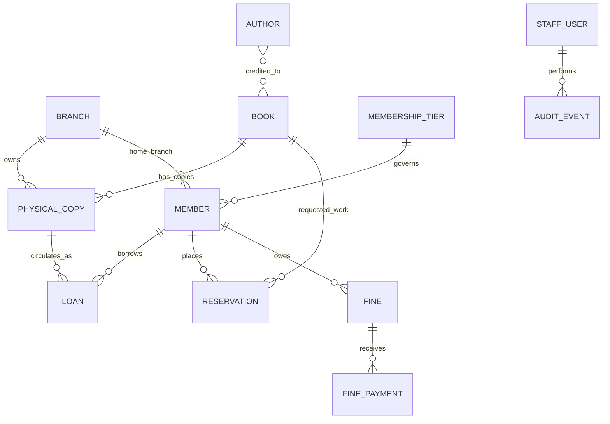

# Data Model and Database Design

## Scope and evidence standard

Pustakalaya uses SQLAlchemy ORM mappings and SQLite, with Alembic migrations. This page is a logical domain overview based on the documented behavior, not a verified physical schema. Before using it as a formal schema submission, compare every entity, field, relationship, constraint, and index against app/models/ and migrations/. Do not treat an illustrative item as proof that a column exists.

## Logical entity inventory

| Entity / concept | Purpose | Relationships to verify in source |
|---|---|---|
| Book / catalog work | Bibliographic metadata such as title, ISBN, category, and language | One catalog work can have multiple physical copies; author relationship/cardinality must be checked. |
| Author | Normalized author identity | Association with catalog works; inspect whether many-to-many and an association table are used. |
| Physical copy | Individual accessioned item, branch, condition, and circulation state | Belongs to a catalog work and branch; participates in loans and reservation allocation. |
| Branch | Library location | Has copies; may be linked to members and operational records. |
| Member | Patron identity, contact details, status, expiry, tier, and home branch | Linked to tier/branch and may have loans, reservations, fines, and history. |
| Membership tier / borrowing policy | Loan limits/duration, renewals, reservation limits, grace period, fine rates/caps, borrowing blocks | Tier-to-member cardinality and policy storage location must be verified. |
| Loan / circulation record | Issue, due date, return, renewal, and copy/member association | References member and physical copy; staff actor fields must be verified. |
| Reservation | Request, queue order, status, pickup deadline | Member and requested work; allocated-copy relation depends on actual schema. |
| Fine | Financial obligation and status | Member and circulation association; exact foreign keys must be verified. |
| Fine payment / ledger entry | Partial/full payments, INR amount, idempotency, receipt, actor | Exact fine/member/payment relationships must be verified. |
| Staff user | Authentication identity, password hash, active state, role | May be actor for audit and operational records. |
| Audit event | Traceable operational/admin actions | Verify actor and target relationships and whether target references are polymorphic. |
| Holiday | Dates affecting due-date and overdue rules | Used by date/policy logic; verify whether stored in a table. |
| Import/data-quality result | Accepted, rejected, quarantined, duplicate, and error outcomes | Verify which outcomes are persisted and which are report-only. |
| Correction record | Controlled data correction history | Verify whether this is a dedicated table or audit metadata. |

## Conceptual relationship diagram

This diagram is a conceptual guide only. Change it to match actual ORM relationships, foreign keys, optionality, and cardinalities before submission.

## Integrity rules documented by the project

- ISBN-10 and ISBN-13 checksum validation; ISBN may be optional for eligible heritage records.
- Unique physical-copy accession identifiers.
- Copy states include AVAILABLE, ON_LOAN, RESERVED, LOST, DAMAGED, and WITHDRAWN.
- Tier-based limits, due dates, renewal/reservation limits, grace periods, fine rates/caps, and borrowing blocks.
- Fine amounts use integer paise storage and Decimal calculations.
- SQLite foreign-key enforcement, WAL mode, busy-timeout handling, explicit write transactions, and conditional updates are documented.
- Reservation processing uses deterministic FIFO and is designed to avoid duplicate allocation side effects on repeat processing.
- Data verification checks migrations, SQLite integrity, foreign keys, counts, and operational invariants.

These are documented behaviors. Verify which are enforced by SQL constraints, ORM configuration, or application logic.

## Required physical-schema appendix

For every actual table, add one row per real column and fill it from the model and migration:

| Table / model | Column | SQL type | PK | FK target | Nullable | Default | Unique/check/index | Meaning |
|---|---|---|---|---|---|---|---|---|
| Fill from source | Fill from source | Fill from source | Yes/No | Exact target or — | Yes/No | Exact value or — | Exact constraint or — | Verified purpose |

Also document exact table names, all columns and timestamps, primary/foreign keys, relationship cardinalities, on-delete and ORM cascade rules, unique/check constraints, indexes/composite keys, status values/transitions, money and date/time conventions, each migration's effect, and tests for important invariants.

## Source evidence to cite

- SQLAlchemy model declarations in app/models/.
- Domain entities, enums, value objects, and policies in app/domain/.
- Repository implementations in app/repositories/.
- Service transaction boundaries in app/services/ and app/infrastructure/.
- Alembic revisions in migrations/versions/.
- Tests under tests/ covering concurrency, fine-payment idempotency, reservation reallocation, and role restrictions.

Do not invent fields, table names, constraints, indexes, tests, or excerpts. Mark details that cannot be verified as unconfirmed.