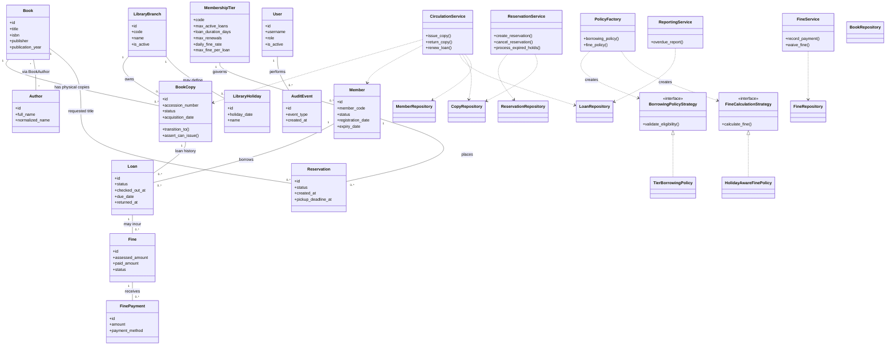

# UML Class Diagram

This diagram summarizes the principal domain and application classes documented in the current codebase. It is a high-level view, not a replacement for the Python source.

## Pattern and boundary notes

- **Strategy:** borrowing eligibility and fine calculation are policy interfaces with replaceable implementations.
- **Factory:** `PolicyFactory` centralizes selection/construction of policy implementations.
- **Service/repository separation:** services orchestrate use cases and transactions; repositories encapsulate persistence queries.
- **Unit of Work / transaction boundary:** write operations are coordinated by the infrastructure transaction helpers so state changes and audit events commit or roll back together.

For implementation details, see [architecture.md](../architecture.md) and [business-rules.md](../business-rules.md). If a class or method is renamed in the code, update this diagram to match.
