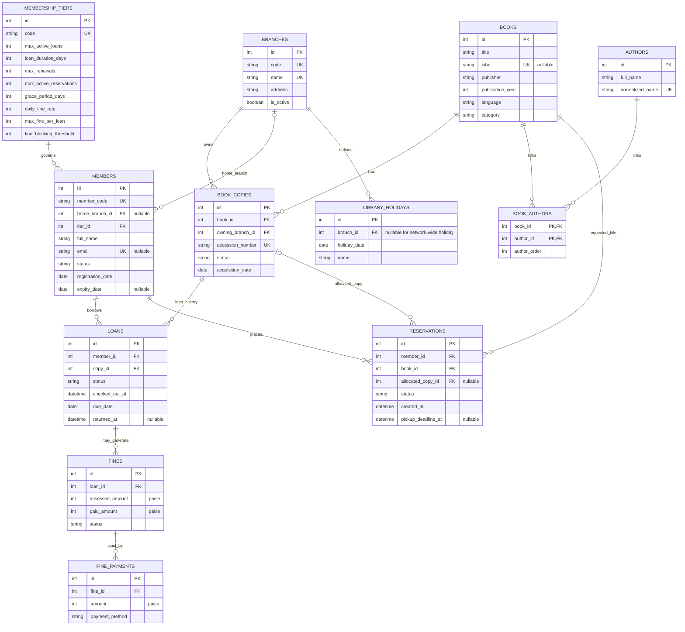

# Entity-Relationship Diagram

This Mermaid ER diagram documents the core circulation and catalog relationships in the SQLAlchemy schema. It intentionally emphasizes the entities central to the stated requirements; audit, authentication, import-batch, and import-issue support tables are described in the architecture/data-quality documentation and should be consulted in `app/models/orm.py` for their complete column-level schema.

## Relationship notes

- `BOOKS` represent catalog works/editions; `BOOK_COPIES` represent individual physical items.
- `BOOK_AUTHORS` is the many-to-many association table and preserves author order.
- A member belongs to one membership tier; a member may have many loans and reservations over time.
- A loan references one physical copy. A partial unique index in the implementation prevents more than one active loan per copy.
- Reservations target a catalog book and may temporarily allocate a physical copy for pickup.
- Fine amounts use integer paise in the SQLite schema to avoid floating-point currency errors.
- Nullable foreign keys are marked as such above. Confirm every column and constraint against the actual migration before using this as a database administration reference.

See [architecture.md](../architecture.md), [business-rules.md](../business-rules.md), and [data-quality.md](../data-quality.md).
